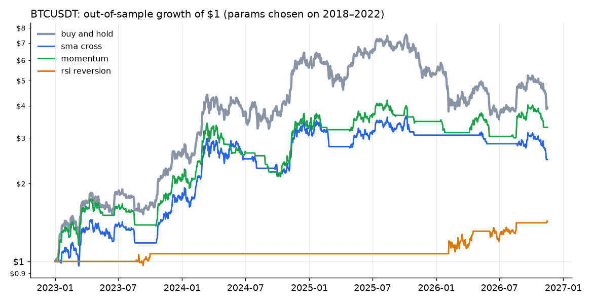
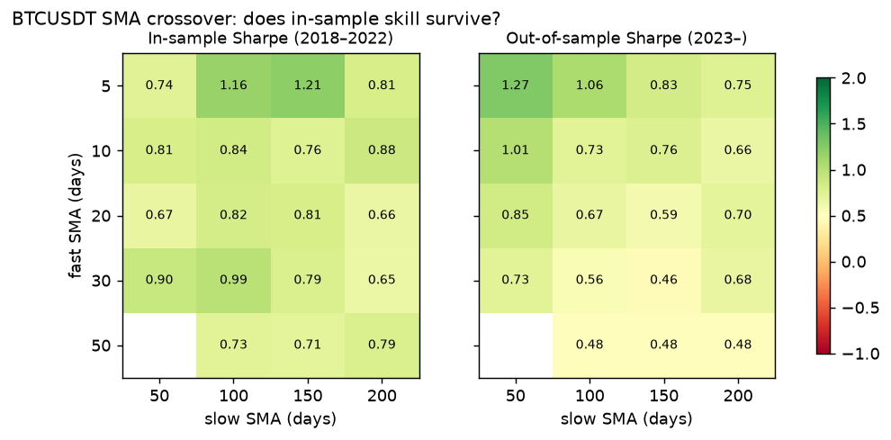

# crypto-backtest-lab

**Do simple trading rules actually beat holding crypto, once you pay fees and stop fooling yourself?**

This project tests three classic long/flat strategies on daily BTC, ETH and SOL data from Binance, and does it the honest way:

- **Parameters are chosen on 2018–2022 only**, then measured on **2023–2026 data they never saw**.
- **No look-ahead:** a signal decided at today's close is only traded tomorrow, and a unit test proves that rewriting future prices can't change past trades.
- **Costs on every trade:** 0.10% fee + 0.05% slippage each time the position changes.
- **Validated data:** the loader refuses to run on missing days, duplicates, or impossible candles.



## Strategies

| Strategy | Rule | Parameters searched |
|---|---|---|
| Buy and hold | Always long (the benchmark) | none |
| SMA crossover | Long while the fast moving average is above the slow one | fast 5–50, slow 50–200 (19 combos) |
| Time-series momentum | Long if price is higher than N days ago | N = 7 to 180 (7 values) |
| RSI mean reversion | Buy when RSI(14) drops below *entry*, sell above *exit* | entry 20–35, exit 50–70 (20 combos) |

Each strategy's best parameter set is picked by **in-sample Sharpe ratio**, and that single choice is what gets reported out-of-sample.

## Results

IS = in-sample (2018–2022, used to pick parameters). OOS = out-of-sample (2023 onwards, never seen during selection). Sharpe ratios are annualised over 365 days with a zero risk-free rate.

#### BTCUSDT  (2018-01-01 to 2026-11-16)

| Strategy | Params (picked in-sample) | IS Sharpe | OOS Sharpe | OOS CAGR | OOS max DD | OOS trades | OOS time in market |
|---|---|---:|---:|---:|---:|---:|---:|
| buy and hold | – | 0.44 | **0.99** | 42.2% | -53.0% | 1 | 100% |
| sma cross | fast=5, slow=150 | 1.21 | **0.83** | 26.4% | -32.2% | 11 | 64% |
| momentum | lookback=60 | 0.98 | **1.05** | 36.0% | -38.0% | 35 | 59% |
| rsi reversion | entry=20, exit=65 | 0.43 | **0.67** | 9.5% | -11.8% | 4 | 14% |

#### ETHUSDT  (2018-01-01 to 2026-11-16)

| Strategy | Params (picked in-sample) | IS Sharpe | OOS Sharpe | OOS CAGR | OOS max DD | OOS trades | OOS time in market |
|---|---|---:|---:|---:|---:|---:|---:|
| buy and hold | – | 0.59 | **0.48** | 11.4% | -67.6% | 1 | 100% |
| sma cross | fast=5, slow=150 | 1.09 | **0.46** | 11.4% | -52.4% | 8 | 56% |
| momentum | lookback=7 | 1.03 | **0.33** | 5.4% | -48.7% | 129 | 50% |
| rsi reversion | entry=25, exit=70 | 0.69 | **0.64** | 17.6% | -35.2% | 5 | 28% |

#### SOLUSDT  (2020-08-11 to 2026-11-16)

| Strategy | Params (picked in-sample) | IS Sharpe | OOS Sharpe | OOS CAGR | OOS max DD | OOS trades | OOS time in market |
|---|---|---:|---:|---:|---:|---:|---:|
| buy and hold | – | 1.05 | **1.02** | 66.2% | -76.3% | 1 | 100% |
| sma cross | fast=5, slow=150 | 1.97 | **0.79** | 35.4% | -49.4% | 14 | 55% |
| momentum | lookback=120 | 1.95 | **0.96** | 50.6% | -65.6% | 19 | 54% |
| rsi reversion | entry=30, exit=60 | 0.33 | **0.51** | 13.3% | -46.7% | 8 | 19% |

## What I learned

1. **In-sample performance flatters you.** The selected strategies' Sharpe ratios fell from as high as 1.97 in-sample to between 0.33 and 1.05 out-of-sample. On SOL, SMA crossover dropped from 1.97 to 0.79.
2. **Buy-and-hold is hard to beat on risk-adjusted return.** Only 2 of 9 strategy/coin pairs beat it out-of-sample: BTC momentum (1.05 vs 0.99) and ETH RSI reversion (0.64 vs 0.48). Both margins are small enough to be luck.
3. **Where the rules do help is drawdowns.** Being out of the market 35–85% of the time cut BTC's worst fall from -53% to -32% (SMA) and ETH's from -68% to -35% (RSI). For a fund with drawdown limits, that can matter more than raw return.
4. **The "best" parameters rarely stay best.** In the heatmap below, the top in-sample BTC setting (5/150) came only 5th out-of-sample, behind 5/50 (OOS Sharpe 1.27), which looked mediocre in-sample. Choosing from a broad region of decent settings is safer than chasing the single peak.



More charts: [ETH](reports/ETHUSDT_oos_equity.png) · [SOL](reports/SOLUSDT_oos_equity.png)

## Run it

```bash
pip install -r requirements.txt
python -m unittest -v              # 13 tests: no look-ahead, costs, metrics, data validation
python -m backtest_lab             # rerun the study on the cached data in data/
python -m backtest_lab --refresh   # re-download candles from Binance first
```

```
backtest_lab/
  data.py        Binance klines download, CSV cache, data validation
  strategies.py  signal functions + parameter grids
  engine.py      next-day execution, costs, metrics (CAGR, Sharpe, Sortino, max DD, Calmar)
  research.py    in-sample selection, out-of-sample evaluation, charts, tables
```

## Limitations

- One train/test split. A rolling walk-forward (re-fit every year) would give a more robust estimate.
- Daily bars, long/flat only: no shorting, leverage, or position sizing.
- Trades are assumed to fill at the daily close plus slippage; real fills vary, especially in fast markets.
- The 2023–2026 out-of-sample period was mostly a bull market, which favours buy-and-hold.
- Parameter selection uses a single metric (Sharpe); with this many combinations some selection bias remains even out-of-sample.

## Next steps

- Rolling walk-forward optimisation and a deflated Sharpe ratio
- Volatility-targeted position sizing
- Portfolio of all three coins with rebalancing
